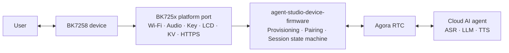

# agora-r1-devkit

[](LICENSE)
[](https://github.com/AgoraIO-Community/agent-studio-device-firmware)
[](https://github.com/bekencorp/bk_avdk_smp)

**[简体中文](README.zh-CN.md) | English**

**agora-r1-devkit** is the BK7258 SMP reference implementation of the open-source
[agent-studio-device-firmware](https://github.com/AgoraIO-Community/agent-studio-device-firmware)
AI voice conversation SDK. This repository organizes
the official Beken SDK and AI solution as pinned Git submodules. The agora-r1-devkit firmware project,
platform port, runtime snapshots, and SDK patches are maintained in this repository. It is
intended to provide reproducible builds, a practical platform development baseline, and a shared
foundation for community collaboration.

> This project is an actively developed BK7258 reference implementation. Before using it in a
> production product, complete the board-level adaptation, security review, and stability
> validation for the target hardware, and verify the licensing and commercial-use terms of all
> third-party components.

## Relationship to agent-studio-device-firmware

[agent-studio-device-firmware](https://github.com/AgoraIO-Community/agent-studio-device-firmware)
is a cross-platform AI voice conversation SDK for
edge devices. Its core is written in C99, uses AOSL as its portable runtime, and obtains device
capabilities such as Wi-Fi, persistent storage, buttons, displays, audio, and network transport
through platform `ops` interfaces.

The local snapshot uses agent-studio-device-firmware SDK 1.3.0 and retains the latest BK7258 audio
lifecycle, device identity implementation, and LCD status badges from the source baseline.

This repository does not redefine the upstream SDK. It provides the complete implementation
required to run the SDK on the BK7258 platform:

- BK7258 AP/CP dual-core startup, memory layout, and Flash partition configuration.
- BK725x Wi-Fi APSTA provisioning, network reconnection, and credential persistence.
- Microphone capture, speaker playback, volume control, and audio power management.
- Button, dual-display, EasyFlash KV, HTTPS, and device UID adapters.
- Full-duplex AI voice sessions over Agora RTSA, including user interruption of AI responses.
- Embedded Chinese and English OGG assets for provisioning prompts and pairing-code announcements.
- A complete flash image and an OTA package containing both the CP and AP firmware.

The device service, Agora RTC cloud service, and cloud AI agent are not part of this repository. A
device service compatible with the SDK protocol is required to run the complete workflow.

## System architecture



The BK7258 firmware uses an AP/CP dual-core architecture:

- **CP** performs base system initialization and SMP startup control.
- **AP** initializes the media service and starts the firmware controller. It hosts the platform
  adapters, device lifecycle, networking, audio, display, and RTC session.
- **Controller** selects APSTA provisioning or normal STA mode according to the saved Wi-Fi
  credentials. After the network connects, it starts the SDK asynchronously and manages
  network recovery and unexpected SDK restarts.

## Repository layout

| Path | Responsibility | Source |
| --- | --- | --- |
| `bk_avdk_smp/` | BK7258 SMP SDK and platform foundation components | [bekencorp/bk_avdk_smp](https://github.com/bekencorp/bk_avdk_smp) |
| `bk_solution_ai/` | Official AI solution components | [bekencorp/bk_solution_ai](https://github.com/bekencorp/bk_solution_ai) |
| `projects/mybot/` | AP/CP entry points, board configuration, partition tables, and prompt assets | This repository |
| `components/mybot/mybot_sdk/` | agent-studio-device-firmware SDK 1.3.0 and the `platforms/bk725x` implementation | Local source snapshot |
| `components/mybot/mybot_aosl/` | AOSL runtime and BK7258 adaptation | Local source snapshot |
| `components/mybot/mybot_rtsa/` | Agora RTSA headers and binary, build `1292388` | Local snapshot |
| `patches/` | Small patches applied when preparing the SDK | This repository |
| `scripts/` | Vendor preparation and language-specific firmware builds | This repository |

The official SDK baselines are fixed at `d2ded037798530175e5dc5cde6fa1878f5d5ef35`
(`bk_avdk_smp`) and `5e3ad9e818d3a3962eb45db23fd71b61238db5af` (`bk_solution_ai`).
This changes source ownership and build integration without upgrading the BK7258 SDK or replacing
the RTSA binary with the BK7259 version. See [official dependencies](docs/OFFICIAL_DEPENDENCIES.md)
for the patch scope and update procedure.

The BK725x platform retains the published R1 baseline
[`6f77b38`](https://github.com/AgoraIO-Community/agora-r1-devkit/tree/6f77b3853ca9a13fd2597e80ee9c494ab8c11812/components/mybot/mybot_sdk/platforms/bk725x),
with `mybot_assets.c` regenerated for the updated pairing audio described below.
The AOSL snapshot and original RTSA library retain their published inputs; see
[snapshot provenance](components/mybot/SNAPSHOTS.md).
The SDK `include/` and `src/` match the official
[agent-studio-device-firmware v1.3.0](https://github.com/AgoraIO-Community/agent-studio-device-firmware/tree/v1.3.0)
commit `32ac74bc59cb72db70e9a68337753561b59b13d0`.
The official revision and checksums are recorded in `components/mybot/mybot_sdk/SDK_REVISION`
and `components/mybot/snapshots.json`.

The local runtime components build for AP only. `CONFIG_AGORA_IOT_SDK` stays disabled because
`mybot_aosl` and `mybot_rtsa` provide the runtime used by this project.

## Requirements

- Git with Git submodule support.
- Python 3 and GNU Make.
- A Linux build environment and the cross-compilation toolchain required by `bk_avdk_smp`.
- A BK7258 development board or compatible hardware using the same peripheral connections.
- Access to a compatible SDK device service and valid Agora service configuration.

For BK7258 SDK environment setup and flashing tools, refer to the
[Beken BK7258 SMP documentation](https://docs.bekencorp.com/arminodoc/bk_avdk_smp/smp_doc/bk7258/en/v3.1.1/index.html).

## Get the source

Clone the repository and its submodules over HTTPS:

```bash
git clone --recurse-submodules https://github.com/AgoraIO-Community/agora-r1-devkit.git
cd agora-r1-devkit
```

If the top-level repository has already been cloned without its submodules, run:

```bash
git submodule sync --recursive
git submodule update --init --recursive
```

After cloning, inspect the pinned revisions with:

```bash
git submodule status
```

## Build the firmware

Run the following command from the repository root to build both language versions:

```bash
python3 scripts/build_all.py
```

`--language both` is the default. To build one version:

```bash
python3 scripts/build_all.py --language zh-CN
python3 scripts/build_all.py --language en-US
```

The build prepares separate project copies for each language, applies the repository's SDK
patches, and builds the CP and AP firmware. It keeps tracked files in the official submodules
clean and leaves the source project configuration unchanged. The complete flash images are:

| File | Purpose |
| --- | --- |
| `releases/bk7258-zh-CN.bin` | Chinese firmware containing the bootloader, CP, and AP |
| `releases/bk7258-en-US.bin` | English firmware containing the bootloader, CP, and AP |

The script also supports `--dry-run`, `--no-clean`, `--build-root`, and `--output-root`.
Images are published only after all requested builds succeed.

For manual builds, prepare one language and run the Make command printed by the script:

```bash
python3 scripts/prepare_vendor.py --language en-US
```

The generated project's `build/bk7258/mybot/package/` directory also contains `all-app.bin`,
`app_pack.rbl` (CP/AP OTA package), and `build_summary.txt` (memory usage report). Individual
CP and AP images are under `build/bk7258/mybot/bk7258/` and `build/bk7258/mybot/bk7258_ap/`.

The input update records successful Chinese and English builds on 2026-10-21; these are
historical results, and the complete firmware build has not been rerun for this update. Hardware
testing remains outstanding. See the [validation record](docs/OFFICIAL_DEPENDENCIES.md#validation).

## Flash and run

Use the Beken flashing tool to write the desired `releases/bk7258-*.bin` image to the device.
These files are copies of the corresponding complete `all-app.bin` images. Follow the instructions for the
target development board and the
[Beken flashing documentation](https://docs.bekencorp.com/arminodoc/bk_avdk_smp/smp_doc/bk7258/en/v3.1.1/get-started/index.html).

The reference device workflow is:

1. On first boot, or when no valid Wi-Fi credentials exist, the device enters APSTA provisioning
   mode and creates a `mybot-xxx` SoftAP.
2. Connect to the SoftAP and open `http://192.168.4.1/`, then select the target network and submit
   its credentials.
3. After connecting to the network, the device starts the SDK and performs device
   registration, pairing, and authentication.
4. An unclaimed device displays and announces its pairing code. After the device is claimed, use
   the action button to start an AI voice conversation.

The current reference-board button mapping is:

| GPIO | Action | Function |
| --- | --- | --- |
| GPIO13 | Short press | Increase volume |
| GPIO8 | Short press | Decrease volume |
| GPIO12 | Short press | Start or stop a conversation |
| GPIO12 | Long press, approximately 3 seconds | Re-enter provisioning mode |

GPIO assignments and display and audio peripheral connections are board-level configuration.
Porting to different BK7258 hardware requires corresponding configuration and platform changes.

## Configuration

The primary project configuration files are:

- AP: `projects/mybot/ap/config/bk7258_ap/config`
- CP: `projects/mybot/cp/config/bk7258/config`
- Flash partitions: `projects/mybot/partitions/bk7258/auto_partitions.csv`
- SRAM/PSRAM layout: `projects/mybot/partitions/bk7258/ram_regions.csv`

The firmware project Kconfig currently provides:

- `CONFIG_MYBOT_LANGUAGE_ZH_CN`: Chinese service region and Chinese prompt assets.
- `CONFIG_MYBOT_LANGUAGE_EN_US`: English service region and English prompt assets.
- `CONFIG_MYBOT_DEBUG_CPU`: Periodically print CPU usage diagnostics; disabled by default.

The language option selects both the service region and the prompt asset directory. Exactly one of
the two language options must be enabled. The source configuration retains its English selection;
the build scripts set the requested language in each generated project copy. Camera and video
variants are not part of these build commands.

| Firmware language | Device-service region | Device-service base URL | TLS root certificate |
| --- | --- | --- | --- |
| `zh-CN` | Mainland China | `https://botstation.shengwang.cn/api` | DigiCert Global Root G2 |
| `en-US` | Overseas | `https://botstation.agora.io/api` | Go Daddy Root Certificate Authority - G2 |

The base URL includes `/api` without a trailing slash, as specified by the upstream SDK.
Each firmware compiles only the root certificate for its region.

## Embedded voice assets

Prompt assets are stored under `projects/mybot/assets/locales/` as 16 kHz mono
Opus-in-Ogg files. They are compiled into the AP firmware as read-only C arrays, require no SD
card, and use no separate `assets_data` partition. Decoded PCM buffers are allocated from PSRAM
at runtime.

After modifying or adding an OGG file, regenerate the C arrays manually before building:

```bash
python3 projects/mybot/scripts/generate_assets_c.py \
  projects/mybot/assets \
  components/mybot/mybot_sdk/platforms/bk725x/modules/storage/mybot_assets.c
```

Intentional source or asset changes require reviewing the changed source, including generated
`mybot_assets.c`, and updating the matching SHA-256 entries in `components/mybot/snapshots.json`.
Use `sha256sum` to calculate the reviewed files' hashes. Builds verify this manifest and do not
silently regenerate it.

The generator collects only `locales/**/*.ogg`. See
[`projects/mybot/assets/README.md`](projects/mybot/assets/README.md) for the audio
format and update procedure.

## Submodule version management

Regular users should keep the revisions pinned by the top-level repository:

```bash
git pull --ff-only
git submodule sync --recursive
git submodule update --init --recursive
```

Do not use `git submodule update --remote` for routine setup or builds. An SDK update is a separate
change: choose official commits, check the local patches and runtime integration, build both
languages, and validate on hardware before updating the gitlinks. Product changes belong in
`projects/mybot/` and `components/mybot/`; SDK changes belong in reviewed patches under `patches/`.
Do not commit generated vendor trees, `build/`, or `__pycache__/` directories. See
[official dependencies](docs/OFFICIAL_DEPENDENCIES.md).

## Documentation

- [agent-studio-device-firmware project](https://github.com/AgoraIO-Community/agent-studio-device-firmware)
- [agent-studio-device-firmware English documentation](https://github.com/AgoraIO-Community/agent-studio-device-firmware/blob/main/README.md)
- [agent-studio-device-firmware porting guide](https://github.com/AgoraIO-Community/agent-studio-device-firmware/blob/main/docs/PORTING.md)
- [agent-studio-device-firmware embedded integration guide](https://github.com/AgoraIO-Community/agent-studio-device-firmware/blob/main/docs/EMBEDDED.md)
- [BK7258 platform component notes](components/mybot/mybot_sdk/README.md)
- [Official dependencies and local patches](docs/OFFICIAL_DEPENDENCIES.md)

## Contributing

Issues and pull requests are welcome:

- Submit platform-independent SDK features and public API changes to the
  [upstream agent-studio-device-firmware project](https://github.com/AgoraIO-Community/agent-studio-device-firmware).
- Submit BK7258 platform and firmware changes to this repository. Keep product code in the local
  project and components, and keep required official SDK changes as small patches. General SDK
  fixes can also be proposed to [Beken](https://github.com/bekencorp).
- Report integration, build, and documentation issues in
  [agora-r1-devkit Issues](https://github.com/AgoraIO-Community/agora-r1-devkit/issues).

Keep each change focused. Describe the hardware, configuration, and validation used, and do not
commit build artifacts.

## License and third-party dependencies

Original content in this top-level repository is licensed under the
[Apache License 2.0](LICENSE).

The two submodules and their third-party components are governed by their respective licenses and
terms of use, including but not limited to:

- [bk_avdk_smp license](bk_avdk_smp/LICENSE)
- [bk_solution_ai license](bk_solution_ai/LICENSE)
- [agent-studio-device-firmware SDK license](components/mybot/mybot_sdk/LICENSE)
- [AOSL license and additional terms](components/mybot/mybot_aosl/aosl/LICENSE)
- [agent-studio-device-firmware third-party notices](https://github.com/AgoraIO-Community/agent-studio-device-firmware/blob/main/THIRD_PARTY_NOTICES.md)

Prebuilt binaries such as Agora RTSA may be subject to evaluation periods, redistribution
restrictions, and commercial licensing requirements. Before using this project in a product or
distributing firmware, independently review and comply with all applicable terms.
