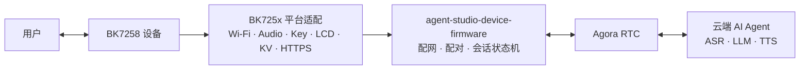

# agora-r1-devkit

[](LICENSE)
[](https://github.com/AgoraIO-Community/agent-studio-device-firmware)
[](https://github.com/bekencorp/bk_avdk_smp)

**简体中文 | [English](README.md)**

**agora-r1-devkit** 是开源 AI 语音对话 SDK
[agent-studio-device-firmware](https://github.com/AgoraIO-Community/agent-studio-device-firmware)
面向 BK7258 SMP 平台的参考实现。
本仓库通过 Git submodule 固定引用 BK 官方 SDK 与 AI 解决方案；agora-r1-devkit 固件工程、平台
适配、运行时快照和 SDK 补丁由本仓库维护，用于复现构建、平台开发和社区协作。

> 本项目当前定位为 BK7258 参考实现，仍在持续开发中。用于量产产品前，请结合实际硬件
> 完成板级适配、安全审查、稳定性验证，并确认所有第三方组件的许可与商业使用条件。

## 与 agent-studio-device-firmware 的关系

[agent-studio-device-firmware](https://github.com/AgoraIO-Community/agent-studio-device-firmware)
是面向边缘设备的跨平台 AI 语音对话 SDK。
其核心采用 C99 编写，依赖 AOSL 提供可移植运行时，并通过平台 `ops` 接口获取 Wi-Fi、
持久化存储、按键、显示、音频和网络传输等设备能力。

本地快照采用 agent-studio-device-firmware SDK 1.3.0，并保留最新 BK7258 源码基线中的音频生命周期、
设备身份实现和 LCD 状态标记。

本仓库不重新定义上游 SDK，而是提供 BK7258 平台所需的完整实现：

- BK7258 AP/CP 双核启动、内存和 Flash 分区配置。
- BK725x Wi-Fi APSTA 配网、网络重连和凭据持久化。
- 麦克风采集、扬声器播放、音量控制及音频电源管理。
- 按键、双屏显示、EasyFlash KV、HTTPS 和设备 UID 适配。
- 基于 Agora RTSA 的全双工 AI 语音会话，并支持用户打断 AI 回复。
- 配网提示和配对码播报所需的中英文内嵌 OGG 资源。
- 完整烧录固件以及同时包含 CP、AP 的 OTA 升级包。

设备服务端、Agora RTC 云服务和云端 AI Agent 不属于本仓库。运行完整业务流程需要接入
与 SDK 协议兼容的设备服务。

## 系统架构



BK7258 固件采用 AP/CP 双核结构：

- **CP** 负责基础系统初始化和 SMP 启动控制。
- **AP** 初始化媒体服务并启动固件控制器，承载平台适配、设备生命周期、网络、
  音频、显示和 RTC 会话。
- **Controller** 根据已保存的 Wi-Fi 凭据选择 APSTA 配网或普通 STA 模式；网络连接后
  异步启动 SDK，并负责断网恢复及异常重启。

## 仓库结构

| 路径 | 职责 | 来源 |
| --- | --- | --- |
| `bk_avdk_smp/` | BK7258 SMP SDK 与平台基础组件 | [bekencorp/bk_avdk_smp](https://github.com/bekencorp/bk_avdk_smp) |
| `bk_solution_ai/` | BK 官方 AI 解决方案组件 | [bekencorp/bk_solution_ai](https://github.com/bekencorp/bk_solution_ai) |
| `projects/mybot/` | AP/CP 入口、板级配置、分区表和提示音资源 | 本仓库 |
| `components/mybot/mybot_sdk/` | agent-studio-device-firmware SDK 1.3.0 及 `platforms/bk725x` 平台实现 | 本地源码快照 |
| `components/mybot/mybot_aosl/` | AOSL 运行时及 BK7258 适配 | 本地源码快照 |
| `components/mybot/mybot_rtsa/` | Agora RTSA 头文件与二进制，build `1292388` | 本地快照 |
| `patches/` | 准备 SDK 时应用的小范围补丁 | 本仓库 |
| `scripts/` | 依赖准备和分语言固件构建 | 本仓库 |

官方 SDK 基线固定为 `bk_avdk_smp` 的 `d2ded037798530175e5dc5cde6fa1878f5d5ef35`
和 `bk_solution_ai` 的 `5e3ad9e818d3a3962eb45db23fd71b61238db5af`。
本次迁移调整源码归属和构建集成，不升级 BK7258 SDK，也不替换为 BK7259 的 RTSA
二进制。补丁范围和版本更新方式见[官方依赖说明](docs/OFFICIAL_DEPENDENCIES.md)。

BK725x 平台适配保留已发布的 R1 基线
[`6f77b38`](https://github.com/AgoraIO-Community/agora-r1-devkit/tree/6f77b3853ca9a13fd2597e80ee9c494ab8c11812/components/mybot/mybot_sdk/platforms/bk725x)，
其中 `mybot_assets.c` 已按下文所述的配对提示音重新生成。
AOSL 快照与 RTSA 静态库保留已发布输入及原始库字节，来源见
[快照说明](components/mybot/SNAPSHOTS.md)。
SDK 的 `include/`、`src/` 与官方
[agent-studio-device-firmware v1.3.0](https://github.com/AgoraIO-Community/agent-studio-device-firmware/tree/v1.3.0)
提交 `32ac74bc59cb72db70e9a68337753561b59b13d0` 一致。
官方版本和校验和记录于 `components/mybot/mybot_sdk/SDK_REVISION` 与
`components/mybot/snapshots.json`。

本地运行时组件只在 AP 目标编译；`mybot_aosl` 和 `mybot_rtsa` 提供工程所需的运行时，
因此保持 `CONFIG_AGORA_IOT_SDK` 关闭。

## 环境要求

- Git，并支持 Git submodule。
- Python 3 和 GNU Make。
- Linux 构建环境及 `bk_avdk_smp` 所需的交叉编译工具链。
- BK7258 开发板或采用相同外设连接的兼容硬件。
- 可用的 SDK 设备服务和 Agora 服务配置。

BK7258 SDK 环境和烧录工具的安装方法请参考
[Beken BK7258 SMP 文档](https://docs.bekencorp.com/arminodoc/bk_avdk_smp/smp_doc/bk7258/zh_CN/v3.1.1/index.html)。

## 获取源码

推荐通过 HTTPS 递归克隆：

```bash
git clone --recurse-submodules https://github.com/AgoraIO-Community/agora-r1-devkit.git
cd agora-r1-devkit
```

已经克隆顶层仓库但尚未获取子模块时执行：

```bash
git submodule sync --recursive
git submodule update --init --recursive
```

克隆完成后，可用以下命令确认固定版本：

```bash
git submodule status
```

## 构建固件

从本仓库根目录执行以下命令，构建中英文两个版本：

```bash
python3 scripts/build_all.py
```

默认参数为 `--language both`，也可以单独构建一种语言：

```bash
python3 scripts/build_all.py --language zh-CN
python3 scripts/build_all.py --language en-US
```

脚本为每种语言准备独立的工程副本，应用本仓库维护的 SDK 补丁，然后编译 CP 和 AP。
官方子模块的受 Git 跟踪文件保持干净，源码工程中的语言配置也不会被改写。完整烧录固件为：

| 文件 | 用途 |
| --- | --- |
| `releases/bk7258-zh-CN.bin` | 包含 bootloader、CP 和 AP 的中文版固件 |
| `releases/bk7258-en-US.bin` | 包含 bootloader、CP 和 AP 的英文版固件 |

脚本还支持 `--dry-run`、`--no-clean`、`--build-root` 和 `--output-root`，仅在所有
请求的构建成功后发布固件。

需要手动构建时，先准备一种语言，再执行脚本打印的 Make 命令：

```bash
python3 scripts/prepare_vendor.py --language en-US
```

生成工程的 `build/bk7258/mybot/package/` 下还包含 `all-app.bin`、CP/AP OTA 升级包
`app_pack.rbl` 和内存报告 `build_summary.txt`。CP、AP 独立镜像分别位于生成工程的
`build/bk7258/mybot/bk7258/` 和 `build/bk7258/mybot/bk7258_ap/`。

本次输入更新保留了 2026-10-21 中英文构建成功的历史记录，本次更新没有重新执行
完整固件构建，尚未进行板端测试。检查内容与历史固件哈希见
[验证记录](docs/OFFICIAL_DEPENDENCIES.md#validation)。

## 烧录与运行

使用 Beken 烧录工具将所需语言的 `releases/bk7258-*.bin` 写入设备；它们分别复制自
对应版本的完整 `all-app.bin`。具体烧录流程以所用开发板和
[Beken 烧录文档](https://docs.bekencorp.com/arminodoc/bk_avdk_smp/smp_doc/bk7258/zh_CN/v3.1.1/get-started/index.html)
为准。

设备启动后的参考流程如下：

1. 首次启动或没有有效 Wi-Fi 凭据时，设备进入 APSTA 配网模式并创建
   `mybot-xxx` SoftAP。
2. 连接该热点并访问 `http://192.168.4.1/`，选择目标网络并提交凭据。
3. 设备连接网络后启动 SDK，完成设备注册、配对和认证。
4. 未认领设备会显示并播报配对码；完成认领后即可通过按键开始 AI 语音会话。

当前参考板按键定义如下：

| GPIO | 操作 | 功能 |
| --- | --- | --- |
| GPIO13 | 短按 | 增大音量 |
| GPIO8 | 短按 | 减小音量 |
| GPIO12 | 短按 | 开始或结束会话 |
| GPIO12 | 长按约 3 秒 | 重新进入配网模式 |

GPIO、显示屏和音频外设连接属于板级配置；适配其他 BK7258 硬件时需要同步修改配置和
平台实现。

## 配置

主要工程配置位于：

- AP：`projects/mybot/ap/config/bk7258_ap/config`
- CP：`projects/mybot/cp/config/bk7258/config`
- Flash 分区：`projects/mybot/partitions/bk7258/auto_partitions.csv`
- SRAM/PSRAM：`projects/mybot/partitions/bk7258/ram_regions.csv`

固件工程的 Kconfig 当前提供：

- `CONFIG_MYBOT_LANGUAGE_ZH_CN`：中文服务区域和中文提示音。
- `CONFIG_MYBOT_LANGUAGE_EN_US`：英文服务区域和英文提示音。
- `CONFIG_MYBOT_DEBUG_CPU`：周期性输出 CPU 使用率诊断信息，默认关闭。

语言选项会同时决定服务区域与提示音目录，两个语言选项必须且只能启用一个。
源码配置保留英文选择；构建脚本在各自生成的工程副本中设置指定语言。上述构建命令
不提供摄像头或视频版本选择。

| 固件语言 | 设备服务区域 | 设备服务地址 | TLS 根证书 |
| --- | --- | --- | --- |
| `zh-CN` | 国内 | `https://botstation.shengwang.cn/api` | DigiCert Global Root G2 |
| `en-US` | 海外 | `https://botstation.agora.io/api` | Go Daddy Root Certificate Authority - G2 |

服务地址按上游 SDK 的约定包含 `/api`，末尾不带 `/`。
每个语言版本只编入对应服务区域的一个根证书。

## 内嵌语音资源

提示音位于 `projects/mybot/assets/locales/`，格式为 16 kHz 单声道
Opus-in-Ogg。资源以只读 C 数组编入 AP 固件，不依赖 SD 卡，也不使用独立的
`assets_data` 分区；解码后的 PCM 缓冲区在运行时从 PSRAM 分配。

修改或新增 OGG 后，需要在构建前手动重新生成数组：

```bash
python3 projects/mybot/scripts/generate_assets_c.py \
  projects/mybot/assets \
  components/mybot/mybot_sdk/platforms/bk725x/modules/storage/mybot_assets.c
```

有意修改源码或资源后，需审查源码差异，包括生成的 `mybot_assets.c`，再用 `sha256sum`
计算修改文件的哈希，并更新 `components/mybot/snapshots.json` 中对应的 SHA-256 记录。
构建只校验该清单，不会静默重新生成清单。

生成器只收集 `locales/**/*.ogg`。详细格式及更新流程见
[`projects/mybot/assets/README.md`](projects/mybot/assets/README.md)。

## 子模块版本管理

普通使用者应使用顶层仓库固定的版本：

```bash
git pull --ff-only
git submodule sync --recursive
git submodule update --init --recursive
```

日常获取源码和构建时不要使用 `git submodule update --remote`。SDK 升级应独立进行：
选定官方提交，核对本地补丁与运行时集成，构建两种语言并完成板端验证后，再更新 gitlink。
产品代码修改放在 `projects/mybot/` 和 `components/mybot/`，必须修改 SDK 的内容维护为
`patches/` 下可审查的补丁。不要提交生成的依赖目录、`build/`、`__pycache__/` 等文件。
详细说明见[官方依赖说明](docs/OFFICIAL_DEPENDENCIES.md)。

## 文档

- [agent-studio-device-firmware 项目](https://github.com/AgoraIO-Community/agent-studio-device-firmware)
- [agent-studio-device-firmware 中文文档](https://github.com/AgoraIO-Community/agent-studio-device-firmware/blob/main/README.zh-CN.md)
- [agent-studio-device-firmware 移植指南](https://github.com/AgoraIO-Community/agent-studio-device-firmware/blob/main/docs/PORTING.zh-CN.md)
- [agent-studio-device-firmware 嵌入式集成指南](https://github.com/AgoraIO-Community/agent-studio-device-firmware/blob/main/docs/EMBEDDED.zh-CN.md)
- [BK7258 平台组件说明](components/mybot/mybot_sdk/README.md)
- [官方依赖与本地补丁](docs/OFFICIAL_DEPENDENCIES.md)

## 贡献

欢迎通过 Issue 和 Pull Request 参与改进：

- 平台无关的 SDK 功能和公共接口改动，请优先提交到
  [agent-studio-device-firmware 上游项目](https://github.com/AgoraIO-Community/agent-studio-device-firmware)。
- BK7258 平台适配和固件工程改动提交到本仓库。产品代码维护在本地工程和组件中，
  必须修改官方 SDK 的内容维护为小范围补丁；通用 SDK 修复也可向
  [Beken 官方](https://github.com/bekencorp) 提交。
- 集成、构建和文档问题可提交到
  [agora-r1-devkit Issues](https://github.com/AgoraIO-Community/agora-r1-devkit/issues)。

提交代码前请保持改动范围清晰，说明使用的硬件、配置和验证方式，并避免将构建产物
提交到版本库。

## 许可证与第三方依赖

本顶层仓库中的原创内容采用 [Apache License 2.0](LICENSE)。

两个子模块及其中的第三方组件分别适用其自身许可和使用条款，包括但不限于：

- [bk_avdk_smp 许可证](bk_avdk_smp/LICENSE)
- [bk_solution_ai 许可证](bk_solution_ai/LICENSE)
- [agent-studio-device-firmware SDK 许可证](components/mybot/mybot_sdk/LICENSE)
- [AOSL 许可证及附加条款](components/mybot/mybot_aosl/aosl/LICENSE)
- [agent-studio-device-firmware 第三方依赖说明](https://github.com/AgoraIO-Community/agent-studio-device-firmware/blob/main/THIRD_PARTY_NOTICES.md)

Agora RTSA 等预编译二进制可能受试用期限、再分发和商业授权限制。将本项目用于产品或
对外分发固件前，请独立核实并遵守所有适用条款。
