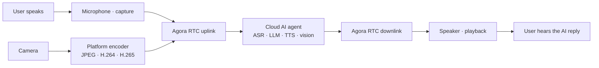
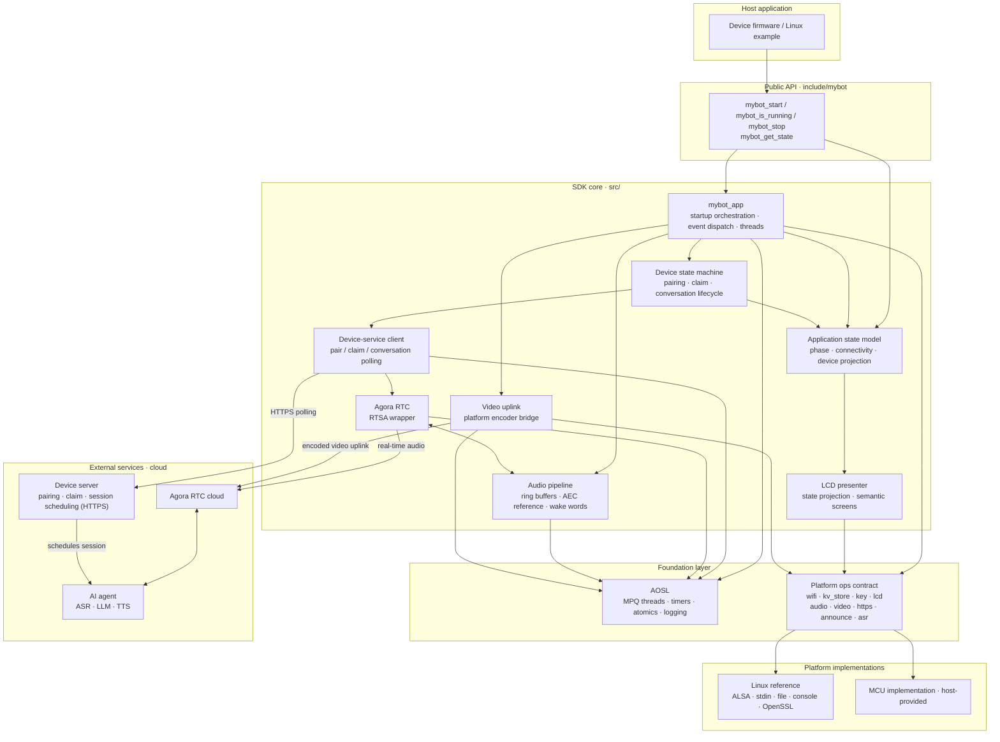
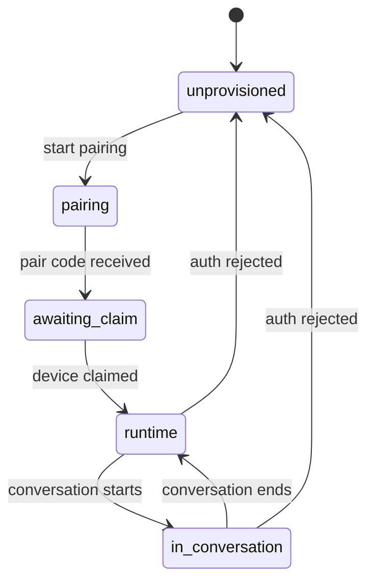
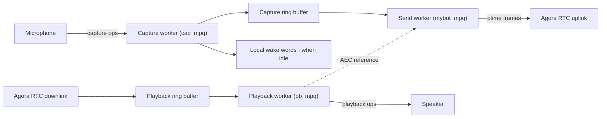
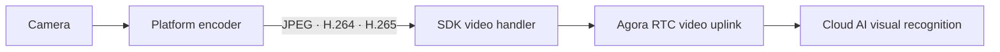

# agent-studio-device-firmware

[](https://github.com/AgoraIO-Community/agent-studio-device-firmware/actions/workflows/ci.yml)
[](LICENSE)

**[English](README.md) | [简体中文](https://github.com/AgoraIO-Community/agent-studio-device-firmware/blob/main/README.zh-CN.md)**

This directory is the SDK source snapshot integrated into
[agora-r1-devkit](../../../README.md). For BK7258 setup, firmware builds, and device operation,
start with the [R1 README](../../../README.md) and [BK725x platform guide](platforms/bk725x/README.md).
The complete SDK project and its Linux development workflow are documented in the public
[upstream README](https://github.com/AgoraIO-Community/agent-studio-device-firmware/blob/main/README.md).

`agent-studio-device-firmware` is a cross-platform **AI multimodal interaction SDK** for edge devices:
it lets smart devices send voice and optional device-camera video to cloud AI agents over Agora RTC for real-time
conversation and visual recognition. The platform/application owns
network provisioning and Wi-Fi credentials; the SDK consumes connectivity events and handles device
pairing and authentication, a conversation state machine, full-duplex voice interaction (Agora RTSA
with Agora AI capabilities), optional device-video uplink, button/LCD workflows, and optional local
wake-word recognition.
Platform-specific capabilities are injected through a small set of `ops` interfaces;
the core depends only on C99 and AOSL and can be ported to virtually any platform — Linux, an
RTOS, or a bare-metal MCU.

> Current version: **1.3.0**. The bundled Agora RTSA
> binary and AOSL have separate licensing and usage terms; read
> [License and third-party dependencies](#license-and-third-party-dependencies) before using the
> SDK in a product.

## Table of Contents

- [Features](#features)
- [Conversation flow](#conversation-flow)
- [Boundaries and limitations](#boundaries-and-limitations)
- [Quick start](#quick-start)
- [Integrating into a host project](#integrating-into-a-host-project)
- [Build configuration](#build-configuration)
- [Architecture](#architecture)
- [Repository layout](#repository-layout)
- [Documentation](#documentation)
- [Development and verification](#development-and-verification)
- [Contributing and support](#contributing-and-support)
- [License and third-party dependencies](#license-and-third-party-dependencies)

## Features

- **Real-time AI conversation**: Hold live voice chats with a cloud AI agent; speech recognition,
  language-model reasoning, and speech synthesis (ASR / LLM / TTS) are orchestrated in the cloud.
- **Multimodal device input**: Optionally upload platform-encoded camera frames so the cloud AI agent
  can perform visual recognition alongside voice. JPEG, H.264, and H.265 are supported; video is
  uplink-only and the server does not send video back to the device.
- **Portable to virtually any platform**: The core depends only on C99 and AOSL, and device
  capabilities are injected through the `ops` contract, so it never touches any OS or peripheral
  API directly — Linux, an RTOS, or a bare-metal MCU.
- **Connectivity integration**: The product owns provisioning; the SDK observes the usable network
  and its runtime disconnect/reconnect events.
- **Pairing and authentication**: Pair code → device claim → persisted long-lived credential, with
  automatic re-pairing when authentication is rejected.
- **Conversation state machine**: Five device-service lifecycle states — `unprovisioned / pairing /
  awaiting_claim / runtime / in_conversation` — drive the device-server interaction.
- **Application lifecycle state**: `mybot_get_state()` exposes startup, device pairing, connectivity,
  shutdown, and conversation state; the values are defined in [mybot.h](include/mybot/mybot.h).
- **Full-duplex voice · barge-in**: Uplink and downlink run simultaneously; the user can interrupt
  the AI mid-reply at any time, and the microphone keeps streaming so the cloud agent hears and
  responds to new input.
- **Full-duplex voice interaction · Agora AI capabilities**: Built on Agora RTSA, with cloud AEC and
  AI QoS.
- **Volume control**: The SDK owns volume. When the platform registers a real-device volume
  implementation (codec / amplifier / mixer), volume changes drive hardware volume directly; otherwise
  the SDK falls back to a digital software gain applied to playback PCM. There is no
  application-facing volume API.
- **Optional local wake words**: Off by default; wake behavior is identical to starting a
  conversation with a physical button.
- **Button and LCD workflows**: Semantic screen states (waiting for network / pairing / pair code / ready /
  in conversation); how each is displayed is up to the platform.
- **Voiceprint registration status**: During an active conversation, the SDK listens on the
  conversation RTM channel for the server's `message.sal_status` / `VP_REGISTER_SUCCESS` message
  and exposes `MYBOT_LCD_INDICATOR_VP_REGISTERED` as an in-conversation LCD overlay.
- **Cloud MCP device commands**: Receive session-bound DeviceCommand v1 messages over RTM to
  set playback volume with `audio.set_volume` or raise/lower it with `audio.adjust_volume`, using
  the cloud's `message.user` envelope.
  The cloud owns MCP tool invocation; the SDK reuses its media volume path. Integration is
  described in [PORTING.md](https://github.com/AgoraIO-Community/agent-studio-device-firmware/blob/main/docs/PORTING.md#mcp-device-commands).
- **Pairing-code voice prompt**: Once per pair code, plays a fixed prompt ("Please enter the
  pairing code in the console") followed by one sound per digit through the normal speaker path.
  The platform owns prompt assets and decoding; the SDK core contains no audio decoder. R1 embeds
  the OGG files in [`projects/mybot/assets/locales`](../../../projects/mybot/assets/locales/) and
  decodes them to 16 kHz mono PCM in its BK725x platform implementation.
- **HTTPS transport**: The device service accepts HTTPS only by default. Linux uses OpenSSL; MCU
  platforms may integrate mbedTLS or a vendor TLS and must validate the certificate chain and host
  name.

## Boundaries and limitations

- Audio is fixed at 16 kHz, mono, 16-bit PCM; `ptime` is configurable to 20/40/60 ms (default
  60 ms).
- Video uplink is optional and uses platform-owned JPEG, H.264, or H.265 encoding. The SDK does not
  encode, decode, buffer, or receive video; it sends one primary encoded stream to the cloud agent.
- The RTC implementation is specific to Agora RTSA; no other RTC protocol adapter is provided.
- Local ASR wake words are an optional platform implementation, off by default; enabling them
  requires the platform to register an implementation.
- The platform/application owns network provisioning and Wi-Fi credential storage; the SDK consumes only
  connectivity events through the Wi-Fi interface.
- The device server is not part of this repository; running the firmware requires a compatible
  server endpoint.

## Conversation flow

The SDK establishes a real-time audio channel and optional encoded video uplink to a cloud AI agent
over Agora RTC, forming a multimodal interaction loop:



- **Uplink**: the device captures 16 kHz PCM from the microphone and sends it to the cloud AI agent
  over Agora RTC.
- **Visual uplink (optional)**: the platform captures and encodes camera frames; the SDK forwards
  the encoded frames over the same RTC channel for cloud-side visual recognition. The server does
  not send video back to the device.
- **Cloud orchestration**: the AI agent performs speech recognition (ASR), language-model reasoning
  and reply generation (LLM), and speech synthesis (TTS).
- **Downlink**: the AI reply audio returns over Agora RTC and plays out on the device speaker.
- **Session scheduling**: the device server handles pairing / claim and allocates the RTC channel for
  each conversation.

The loop is **full-duplex**: uplink and downlink run at the same time, with no turn-taking. The user
can **interrupt** the AI at any point mid-reply — the device keeps the microphone streaming, and the
cloud agent detects the new input, stops its reply, and listens for the new command.

For the device-side audio pipeline and state machine, see [Architecture](#architecture).

## Quick start

Follow [Get the source](../../../README.md#get-the-source) to initialize the pinned BK dependencies,
then run this command from the `agora-r1-devkit` repository root:

```bash
python3 scripts/build_all.py
```

The [R1 build instructions](../../../README.md#build-the-firmware) describe toolchain requirements,
language selection, generated images, and flashing. For the standalone Linux reference application,
use the complete upstream project's
[quick start](https://github.com/AgoraIO-Community/agent-studio-device-firmware/blob/main/README.md#quick-start).

### Device-service addresses

Choose the base URL for the device's region through `mybot_config_t.server_base`, including `/api`
without a trailing slash. The [R1 language configuration](../../../README.md#configuration) selects
the matching service region, prompt assets, and TLS root certificate.

| Region | Device-service base URL |
| --- | --- |
| Mainland China | `https://botstation.shengwang.cn/api` |
| Overseas | `https://botstation.agora.io/api` |

`device_id` is the globally unique, stable identity of one physical device. Product and device
registration systems must ensure that each ID belongs to exactly one device.
Each chip platform uses a distinct, fixed chip prefix to isolate its ID namespace, so identical
digest suffixes on different platforms still produce different complete IDs.
The product generates it as `<chip>-<24 uppercase hex characters>`: use the first
12 bytes of HMAC-SHA256 over its stable MAC address, with a fixed platform derivation key.
The chip prefix is at most 7 ASCII characters, so the complete ID is at most 32 characters,
excluding the terminating NUL. The SDK receives this ID; it does not generate it.

For the BK7258 provisioning, pairing, and button workflow, see
[Flash and run](../../../README.md#flash-and-run). Prompt generation is described under
[Embedded voice assets](../../../README.md#embedded-voice-assets).

## Integrating into a host project

The R1 integration builds this snapshot as an Armino component using
[`CMakeLists.txt`](CMakeLists.txt), with separate
[AOSL](../mybot_aosl/CMakeLists.txt) and [RTSA](../mybot_rtsa/CMakeLists.txt) components.
The [AP entry point](../../../projects/mybot/ap/ap_main.c) starts the
[BK725x controller](platforms/bk725x/modules/controller/), which registers the platform and manages
network readiness before starting the SDK. Snapshot versions and checksums are recorded in
[SNAPSHOTS.md](../SNAPSHOTS.md).

For source-submodule or installed-package integration of the complete SDK, consult the public
[upstream integration guide](https://github.com/AgoraIO-Community/agent-studio-device-firmware/blob/main/README.md#integrating-into-a-host-project).
Those CMake package targets belong to that upstream project.

Register one `mybot_platform_descriptor_t` before `mybot_start()`. A non-NULL ops pointer is the sole
declaration that the platform supports that function. Registration validates the complete descriptor,
including the required Wi-Fi, KV, key, capture, and playback tables, before committing the complete
descriptor.
`mybot_start()` then checks the ops required by the active build and runtime configuration before
creating any platform resources. Every platform is submitted through this one descriptor. For the
full implementation order, minimal code, threading constraints, and acceptance checklist, see
[docs/PORTING.md](https://github.com/AgoraIO-Community/agent-studio-device-firmware/blob/main/docs/PORTING.md).

The product completes network provisioning before starting the SDK and stops the SDK before entering
provisioning again. The SDK owns device-service pairing and conversations, independently of that
network setup. See [PORTING: start and stop](https://github.com/AgoraIO-Community/agent-studio-device-firmware/blob/main/docs/PORTING.md#step-6-start-and-stop) for the
integration sequence and example, and [mybot.h](include/mybot/mybot.h) for the API contract.

R1 links the target-specific RTSA static library recorded in [SNAPSHOTS.md](../SNAPSHOTS.md).
Other products must provide RTSA headers and a library matching their target architecture and an
AOSL HAL for that platform.

## Build configuration

R1 uses the BK project configuration and component wrappers:

- [AP configuration](../../../projects/mybot/ap/config/bk7258_ap/config) and
  [CP configuration](../../../projects/mybot/cp/config/bk7258/config) select board and SDK features.
- [Project Kconfig](../../../projects/mybot/ap/Kconfig.projbuild) defines language and CPU diagnostic options.
- [SDK configuration header](include/mybot/mybot_build_config.h) defines the core feature defaults.
- [Configuration](../../../README.md#configuration) explains service regions and the supported firmware variants.

The complete upstream SDK has a separate CMake configuration interface described in its
[build configuration guide](https://github.com/AgoraIO-Community/agent-studio-device-firmware/blob/main/README.md#build-configuration).

## Architecture

The SDK uses a layered architecture: the host application drives the core through the public API,
the core modules sit on top of the AOSL portability layer and the platform `ops` contract, and all
platform differences are absorbed by the platform implementations. The device server, the Agora RTC cloud,
and the cloud AI agent are runtime external dependencies and are not part of this repository.



Layer notes:

- **Public API** ([include/mybot/mybot.h](include/mybot/mybot.h)): application lifecycle and
  state queries (`mybot_start` / `mybot_is_running` / `mybot_get_state` / `mybot_stop`);
  non-blocking startup. Use `mybot_get_state()` for key or UI decisions:
  `MYBOT_STATE_READY` can start a conversation and `MYBOT_STATE_IN_CONVERSATION` can stop one;
  `MYBOT_STATE_PAIRING` is not conversation-ready. LCD output is only a rendering result, not a
  source of lifecycle state. Conversation and pairing actions are triggered by platform key /
  wake-word events and handled inside the SDK core. Wi-Fi and device-lifecycle events update one
  atomic state-model snapshot; `mybot_get_state()` and the LCD presenter derive their views from
  that same snapshot.
- **SDK core** ([src/](src/)): one control owner serializes application state, the device lifecycle,
  UI and volume actions, and resource startup and shutdown. RTC commands are forwarded synchronously
  to the dedicated `rtc_mpq`, which serializes RTSA lifecycle, vendor calls, and callbacks. Control
  callbacks only publish short events or atomic mailboxes to their owner. The core also contains the
  device-service HTTP client, the Agora RTSA session wrapper, audio ring buffers, the optional video
  uplink bridge, and the optional local wake-word engine. Core code never touches any OS or
  peripheral API directly.
- **Foundation layer**: AOSL provides portable threads / MPQ queues / timers / logging; the
  platform `ops` contract defines the device capabilities the SDK requires. Both are implementable
  per platform.
- **Platform implementations**: the Linux reference implementation and each MCU platform register
  against the same contract.
- **External services**: the device server (pairing / claim / session scheduling, HTTPS only), the
  Agora RTC cloud (real-time audio and optional video transport), and the cloud AI agent (speech
  recognition / understanding / synthesis / visual recognition).

### Threading model

Application control, background device-service HTTP, RTC, capture, playback, and audio sending
use separate workers. `service_mpq` handles binding-status polling and stop notifications; their
results return to `control_mpq`, which owns lifecycle state. HTTPS adapters must support concurrent
independent connections. The platform owns the optional video encoder task.
For the thread/stack budget, dynamic allocations, and timing
measurements, see [EMBEDDED](https://github.com/AgoraIO-Community/agent-studio-device-firmware/blob/main/docs/EMBEDDED.md); platform callback contracts live in the
[public headers](include/mybot/platform/).

### Workflows

#### Device state machine



When device authentication is rejected, the device returns to `unprovisioned` and automatically
restarts pairing on the next state-machine tick.

#### Audio data flow



With `MYBOT_CLOUD_AEC=ON`, the downlink audio is interleaved with the microphone signal as a
reference channel and sent uplink together, letting the server cancel echo. The uplink and downlink
run concurrently (**full-duplex**): the microphone keeps streaming during AI replies, which is what
lets the cloud agent support user interruption.

#### Multimodal video flow



The video handler uses RTSA's target-bitrate callback to let the platform encoder adapt to current
uplink capacity. The device sends only the primary video stream; remote video subscription is off.

## Repository layout

Paths below are relative to this SDK directory:

```text
mybot_sdk/
├── include/mybot/          # public headers and platform interface specifications
├── src/                    # cross-platform implementation; internal/ is not public API
├── platforms/bk725x/       # BK adapters, modules, and application controller
├── CMakeLists.txt          # R1 Armino component source list and dependencies
├── SDK_REVISION            # SDK source version and provenance
└── LICENSE                 # SDK license
```

The [R1 repository layout](../../../README.md#repository-layout) locates the firmware project,
AOSL, RTSA, assets, and build scripts. The complete upstream project's layout and CMake package
targets are described in its
[README](https://github.com/AgoraIO-Community/agent-studio-device-firmware/blob/main/README.md#repository-layout).

## Documentation

This R1 snapshot contains the SDK core and BK725x integration. The links to the complete SDK
project below are public upstream documentation; R1 board configuration, dependencies, and firmware
builds are documented in this repository.

- [Public headers](include/mybot/) — authoritative API and platform contracts; this README is the overview
- [docs/PORTING.md](https://github.com/AgoraIO-Community/agent-studio-device-firmware/blob/main/docs/PORTING.md) ([简体中文](https://github.com/AgoraIO-Community/agent-studio-device-firmware/blob/main/docs/PORTING.zh-CN.md)) — porting guide and
  integration sequence and acceptance checklist
- [R1 README](../../../README.md) and [BK725x platform guide](platforms/bk725x/README.md) — current BK7258 integration
- [agora-r2-standard-devkit](https://github.com/AgoraIO-Community/agora-r2-standard-devkit) — BK7259 reference firmware project
- [agora-esp32-devkit](https://github.com/AgoraIO-Community/agora-esp32-devkit) — ESP32 cross-platform reference project
- [docs/EMBEDDED.md](https://github.com/AgoraIO-Community/agent-studio-device-firmware/blob/main/docs/EMBEDDED.md) ([简体中文](https://github.com/AgoraIO-Community/agent-studio-device-firmware/blob/main/docs/EMBEDDED.zh-CN.md)) — footprint, memory,
  thread/stack, timing, power and logging guidance for MCU integrators
- [docs/RELEASING.md](https://github.com/AgoraIO-Community/agent-studio-device-firmware/blob/main/docs/RELEASING.md) ([简体中文](https://github.com/AgoraIO-Community/agent-studio-device-firmware/blob/main/docs/RELEASING.zh-CN.md)) — release process
- [CHANGELOG.md](https://github.com/AgoraIO-Community/agent-studio-device-firmware/blob/main/CHANGELOG.md) — version history
- API reference — use the [local public headers](include/mybot/); the upstream SDK
  [CI workflow](https://github.com/AgoraIO-Community/agent-studio-device-firmware/blob/main/.github/workflows/ci.yml)
  describes its generated Doxygen artifacts

## Development and verification

Follow the [R1 dependency and validation guide](../../../docs/OFFICIAL_DEPENDENCIES.md) for the
checks applicable to this firmware project. From the R1 repository root, after initializing the
pinned BK dependencies, verify the source snapshots with:

```bash
python3 scripts/check_sources.py
```

Snapshot changes require review and matching checksum updates as described in
[SNAPSHOTS.md](../SNAPSHOTS.md). Firmware build and hardware-validation requirements are described
in the [R1 README](../../../README.md#build-the-firmware).

The complete upstream SDK's Linux unit tests, sanitizers, formatting checks, and commit-hook setup
are documented in its public
[development guide](https://github.com/AgoraIO-Community/agent-studio-device-firmware/blob/main/README.md#development-and-verification)
and [contribution guide](https://github.com/AgoraIO-Community/agent-studio-device-firmware/blob/main/CONTRIBUTING.md).
Run that workflow from a checkout of the complete upstream project.

## Contributing and support

For R1 firmware contributions and support, start with the
[R1 contribution guidance](../../../README.md#contributing). The complete SDK project's public
upstream guides are available in English and Simplified Chinese:

- [CONTRIBUTING](https://github.com/AgoraIO-Community/agent-studio-device-firmware/blob/main/CONTRIBUTING.md) ([简体中文](https://github.com/AgoraIO-Community/agent-studio-device-firmware/blob/main/CONTRIBUTING.zh-CN.md)) — development workflow and contribution guidelines
- [SUPPORT](https://github.com/AgoraIO-Community/agent-studio-device-firmware/blob/main/SUPPORT.md) ([简体中文](https://github.com/AgoraIO-Community/agent-studio-device-firmware/blob/main/SUPPORT.zh-CN.md)) — how to get help

## License and third-party dependencies

Our own code is released under the Apache License 2.0 in the root [LICENSE](LICENSE). This does not
change the licensing of third-party components:

- AOSL carries additional conditions listed in its [local LICENSE](../mybot_aosl/aosl/LICENSE).
- The Agora RTSA SDK binary is subject to its software license, trial period, and commercial
  licensing requirements. R1 bundles a BK7258 ARM RTOS static library; see the
  [local package provenance and metadata notes](../SNAPSHOTS.md) and
  [R1 licensing guidance](../../../README.md#license-and-third-party-dependencies).
  Commercial or production use and redistribution require authorization from Agora (声网) — contact
  Agora's sales channel before shipping or redistributing it.
- `mybot_json` is derived from cJSON and retains the MIT license notice.

Verify these terms independently before shipping or redistributing a product. See
[THIRD_PARTY_NOTICES.md](https://github.com/AgoraIO-Community/agent-studio-device-firmware/blob/main/THIRD_PARTY_NOTICES.md) for details.
